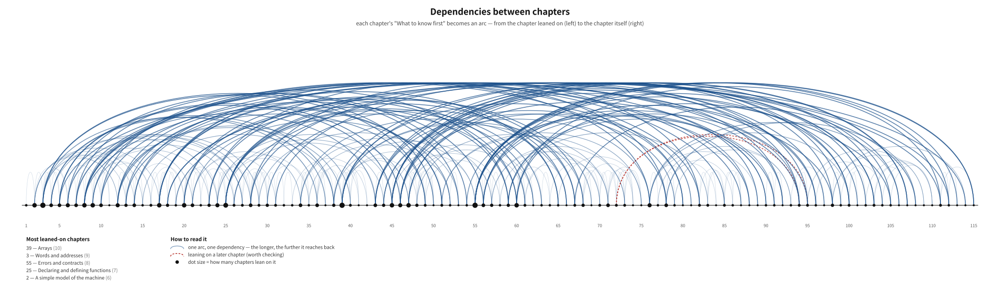

# Dependencies between chapters

This document is not written by hand but **extracted from the manuscript**.
Each chapter's `What to know first` entries declare "this chapter leans on that one",
and `scripts/make-depgraph.py` reads them to build this picture and these tables.
Re-run it whenever the manuscript changes.

- Chapters: **115**
- Dependencies: **259**
- Chapters leaning on nothing: 1

## Leaning on a later chapter

Unusual in a book read linearly — worth checking whether it is intended.

- Ch. 72 → Ch. 94 — listed as a prerequisite before it is reached
- Ch. 72 → Ch. 95 — listed as a prerequisite before it is reached

## The most leaned-on chapters — this book's pillars

| Ch. | Title | Chapters leaning on it |
|---|---|---|
| 39 | Arrays | 10 |
| 3 | Words and addresses — the archetype of C | 9 |
| 55 | Errors and contracts | 8 |
| 2 | A simple model of the machine — the birth of C | 6 |
| 8 | Characters and text — scars in the standard | 6 |
| 9 | The origin of streams — punched cards, line printers, printing terminals | 6 |
| 17 | The general shape of compilation | 6 |
| 20 | The structure of a program | 6 |
| 25 | Declaring and defining functions | 6 |
| 45 | Lifetime and storage duration | 6 |
| 47 | Structs | 6 |
| 60 | Building out of several files — translation units and linkage | 6 |

## Full table by part

## Chapters nothing leans on yet

Mostly the closing part. One near the front may be weakly connected.

11, 37, 41, 42, 50, 53, 66, 69, 74, 75, 80, 81, 84, 87, 88, 89, 92, 97, 101, 106, 107, 108, 109, 110, 113, 114, 115

---

Generated by `python3 scripts/make-depgraph.py`
