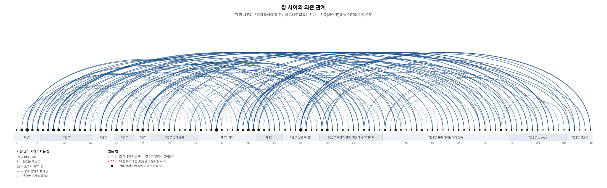

# 장 사이의 의존 관계

이 문서는 손으로 적은 것이 아니라 **원고에서 뽑아낸 것**이다. 각 장 서두의
`먼저 알아야 할 것` 항목이 「이 장은 저 장에 기댄다」는 선언이므로,
`scripts/make-depgraph.py` 가 그것을 읽어 이 그림과 표를 만든다.
원고가 바뀌면 다시 돌려서 갱신한다.

- 장 수: **110**
- 의존 관계 수: **240**
- 아무것에도 기대지 않는 장: 1

## 뒤 장에 기대는 자리

없다. 모든 장이 자기보다 앞선 장에만 기댄다.

## 많이 기대어지는 장 — 이 책의 기둥

| 장 | 제목 | 기대는 장 수 |
|---|---|---|
| 39 | 배열 | 10 |
| 3 | 워드와 주소 — C의 원형 | 9 |
| 55 | 오류와 계약 | 8 |
| 25 | 함수 선언과 정의 | 7 |
| 2 | 단순한 기계 모델 — C의 탄생 | 6 |
| 8 | 문자와 텍스트 — 표준 속의 흉터 | 6 |
| 9 | 스트림의 기원 — 펀치카드, 라인프린터, 프린터 터미널 | 6 |
| 17 | 일반적인 컴파일 과정(compilation) | 6 |
| 20 | 프로그램의 구조 | 6 |
| 45 | 수명과 저장 기간 | 6 |
| 47 | 구조체 | 6 |
| 60 | 여러 파일로 나누어 짓기 — 번역 단위와 연결 | 6 |

## 부별 전체 표

### 제1부 — 바탕: 기계와 기억

| 장 | 제목 | 기댄 곳 | 이 장에 기대는 곳 |
|---|---|---|---|
| 1 | 배경설명 | — | 2 |
| 2 | 단순한 기계 모델 — C의 탄생 | 1 | 3, 6, 12, 13, 15, 17 |
| 3 | 워드와 주소 — C의 원형 | 2 | 4, 5, 6, 12, 14, 24, 36, 49, 50 |
| 4 | 주소의 특수 지식 — 0번지, 정렬, 하위 비트 | 3 | 5, 27, 37, 38 |
| 5 | 기억의 구역들 — 프로그램은 어디에 무엇을 두는가 | 3, 4 | 10, 45, 46, 93 |

### 제2부 — 기계의 진짜 모습: 표현과 실행

| 장 | 제목 | 기댄 곳 | 이 장에 기대는 곳 |
|---|---|---|---|
| 6 | 정수의 표현 — 부호, 오버플로, 시프트 | 2, 3 | 7, 21, 28, 29, 53 |
| 7 | 수의 표현 — IEEE 754라는 계약 | 6 | 8, 27, 54, 83 |
| 8 | 문자와 텍스트 — 표준 속의 흉터 | 7 | 9, 43, 77, 80, 82, 100 |
| 9 | 스트림의 기원 — 펀치카드, 라인프린터, 프린터 터미널 | 8 | 10, 11, 16, 23, 26, 73 |
| 10 | 프로그램과 프로세스 — 실행된다는 것 | 5, 9 | 11, 16, 59, 86 |
| 11 | 멀티태스킹과 인터럽트 — 번갈아 도는 기계 | 9, 10 | — |
| 12 | 기억의 분화 — 레지스터, 캐시, 다층의 사다리 | 2, 3 | 13, 39, 40, 51, 90 |
| 13 | 속도의 기계장치 — 표준의 탄생 | 2, 12 | 14, 51, 89 |
| 14 | 컴파일러 최적화 — 추상 기계 | 13, 3 | 15, 20, 49, 56 |
| 15 | 그래서 C는 추상적인 언어다 | 14, 2 | 38 |

### 제3부 — 첫 프로그램

| 장 | 제목 | 기댄 곳 | 이 장에 기대는 곳 |
|---|---|---|---|
| 16 | 헬로 월드 | 9, 10 | 17, 20 |
| 17 | 일반적인 컴파일 과정(compilation) | 16, 2 | 18, 19, 60, 61, 65, 71 |
| 18 | 개발환경 구축 | 17 | 19, 106, 107 |
| 19 | 컴파일러의 지형 — 현역 C 컴파일러들 | 17, 18 | 109 |

### 제4부 — 최소한의 도구 상자

| 장 | 제목 | 기댄 곳 | 이 장에 기대는 곳 |
|---|---|---|---|
| 20 | 프로그램의 구조 | 16, 14 | 21, 22, 23, 24, 59, 65 |
| 21 | 수식과 상수 — 값이 되는 것 | 6, 20 | 22, 31, 34, 52 |
| 22 | 함수 사용 — 부르는 법 | 21, 20 | 25 |
| 23 | 출력 | 9, 20 | 26, 67, 73 |

### 제5부 — 선언: 이름을 만드는 법

| 장 | 제목 | 기댄 곳 | 이 장에 기대는 곳 |
|---|---|---|---|
| 24 | 변수 선언 | 3, 20 | 25, 27, 28, 35, 47 |
| 25 | 함수 선언과 정의 | 22, 24 | 34, 45, 60, 62, 63, 66, 68 |
| 26 | 입력 | 23, 9 | 44, 103 |

### 제6부 — 값과 흐름

| 장 | 제목 | 기댄 곳 | 이 장에 기대는 곳 |
|---|---|---|---|
| 27 | 타입의 갈래 — 표준이 가른 것들 | 24, 4, 7 | 28, 30 |
| 28 | 정수 — 유한한 수의 세계 | 27, 6, 24 | 29, 30, 77, 91 |
| 29 | 정수의 연산 — 나눗셈, 비트 | 6, 28 | 30, 53 |
| 30 | 암묵적 변환(implicit conversion) — 승격과 통상 산술 변환 | 27, 28, 29 | 31, 35, 67 |
| 31 | 불리언과 비교 | 21, 30 | 32, 92 |
| 32 | 결정 — if와 switch | 31 | 33 |
| 33 | 반복 — 루프와 불변식 | 32 | 42 |
| 34 | 함수의 의미 — 값 복사와 부수효과 | 25, 21 | 35, 36, 55, 66 |
| 35 | 대입과 부수효과 | 24, 34, 30 | 52 |

### 제7부 — 기억

| 장 | 제목 | 기댄 곳 | 이 장에 기대는 곳 |
|---|---|---|---|
| 36 | 객체, 주소, 포인터 | 3, 34 | 37, 38, 39, 41 |
| 37 | 널 — 삼형제의 정식 취급 | 4, 36 | — |
| 38 | 포인터의 규칙 — 정렬과 프로버넌스 | 36, 4, 15 | 40, 57, 98 |
| 39 | 배열 | 36, 12 | 40, 41, 43, 47, 48, 52, 68, 69, 75, 98 |
| 40 | 다차원 배열 | 39, 38, 12 | 41, 42 |
| 41 | 배열과 포인터 — 언제 같고 언제 다른가 | 39, 40, 36 | — |
| 42 | 반복의 기법 — 중첩, 탈출, 그리고 블록 만들기 | 33, 40 | — |
| 43 | 문자열 | 8, 39 | 44, 75, 95, 100 |
| 44 | 안전한 입력 — 넘침을 막고, 실패를 다루기 | 26, 43 | 55, 71, 74 |
| 45 | 수명과 저장 기간 | 25, 5 | 46, 62, 87, 89, 90, 93 |
| 46 | 동적 메모리 | 45, 5 | 58, 76, 94, 99, 102 |

### 제8부 — 자료의 모양

| 장 | 제목 | 기댄 곳 | 이 장에 기대는 곳 |
|---|---|---|---|
| 47 | 구조체 | 24, 39 | 48, 49, 52, 61, 84, 102 |
| 48 | 구조체를 부리는 법 — 임시 값, 이름 붙은 인자, 배치 | 47, 39 | 50, 51 |
| 49 | 공용체와 표현 | 47, 3, 14 | 50, 57 |
| 50 | 직렬화 --- 기억 속 값을 바이트의 약속으로 | 48, 49, 3 | — |
| 51 | 자료 배치와 캐시 --- 구조체의 배열인가, 배열의 구조체인가 | 12, 13, 48 | — |

### 제9부 — 깊은 구석들

| 장 | 제목 | 기댄 곳 | 이 장에 기대는 곳 |
|---|---|---|---|
| 52 | 수식과 연산자 | 21, 35, 39, 47 | 53 |
| 53 | 비트를 다루는 법 --- 관용구와 함정 | 6, 29, 52 | — |
| 54 | 실수 — 근사의 수학 | 7 | 83 |
| 55 | 오류와 계약 | 34, 44 | 56, 85, 87, 95, 97, 107, 108, 110 |
| 56 | 정의되지 않은 동작 | 14, 55 | 57, 85, 91, 110 |
| 57 | 메모리 사고 도감 | 38, 49, 56 | 58 |
| 58 | 메모리를 다스리는 법 --- 수명, 소유, 그리고 다른 언어의 수집기 | 46, 57 | 70 |

### 제10부 — 구성과 연결: 파일에서 객체까지

| 장 | 제목 | 기댄 곳 | 이 장에 기대는 곳 |
|---|---|---|---|
| 59 | `main`의 세 얼굴 — 진입점과 종료 상태 | 10, 20 | 78, 86, 89 |
| 60 | 여러 파일로 나누어 짓기 — 번역 단위와 연결 | 17, 25 | 61, 62, 63, 64, 96, 106 |
| 61 | 링크와 ABI — 이진 수준의 약속 | 60, 17, 47 | 66 |
| 62 | 이름이 쓰일 수 있는 범위 — 스코프 | 25, 45, 60 | — |
| 63 | 이름의 세계 — 네 이름 공간과 세 축 | 25, 60 | 64 |
| 64 | 이름 충돌을 다루는 법 — 접두어에서 `namespace`까지 | 60, 63 | 70 |
| 65 | 전처리기와 번역 단계 | 17, 20 | 70 |
| 66 | 함수 선언과 호출식 --- 부르는 일의 안쪽 | 25, 34, 61 | — |
| 67 | 가변 인자 함수 | 23, 30 | 70, 101 |
| 68 | 함수를 값으로 — 함수 포인터 | 25, 39 | 69, 70 |
| 69 | 선언을 읽는 법 — 두 가지 독법과 `typedef` | 68, 39 | — |
| 70 | C 로 하는 객체 지향 --- 흉내의 기술과 그 한계 | 68, 64, 58, 65, 67 | — |

### 제11부 — 표준 라이브러리 정독

| 장 | 제목 | 기댄 곳 | 이 장에 기대는 곳 |
|---|---|---|---|
| 71 | 표준 라이브러리의 지형 | 44, 17 | 72, 76, 84, 95, 101 |
| 72 | 표준 라이브러리 한눈에 보기 | 71 | 88 |
| 73 | 스트림의 실제 — `<stdio.h>` ① | 9, 23 | 74, 79, 81, 103 |
| 74 | 읽고 쓰기의 함정 — `<stdio.h>` ② | 73, 44 | 88 |
| 75 | 문자열과 기억 — `<string.h>` | 43, 39 | — |
| 76 | 잡동사니 서랍 — `<stdlib.h>` | 71, 46 | — |
| 77 | 문자 분류 — `<ctype.h>` | 8, 28 | 78, 80 |
| 78 | 로케일 ① — 프로그램의 지역 설정 | 77, 59 | 79, 80 |
| 79 | 로케일 ② — 숫자·통화·시간·정렬 | 78, 73 | — |
| 80 | 와이드 문자 ① — `wchar_t`와 멀티바이트 변환 | 8, 78, 77 | 81, 82 |
| 81 | 와이드 문자 ② — 플랫폼의 현실과 와이드 입출력 | 80, 73 | 82 |
| 82 | 실무 — 유니코드와 멀티바이트를 다루는 법 | 81, 80, 8 | — |
| 83 | 수 — `<math.h>`·`<fenv.h>`·`<tgmath.h>` | 54, 7 | — |
| 84 | 시간 — `<time.h>` | 47, 71 | — |
| 85 | 진단과 제어 — `<errno.h>`·`<assert.h>`·`<signal.h>`·`<setjmp.h>` | 55, 56 | 86 |
| 86 | 신호 — `<signal.h>` | 85, 59, 10 | 87 |
| 87 | 비지역 점프 — `<setjmp.h>` | 86, 45, 55 | — |
| 88 | 새 표준이 보탠 것과 `*_s` 논쟁 | 72, 74 | 92 |
| 89 | 갈래를 나누어 돌리기 — `<threads.h>` | 13, 45, 59 | 90 |
| 90 | 쪼개지지 않는 연산 — `<stdatomic.h>` | 89, 12, 45 | 104 |
| 91 | 넘침을 묻는 법 — `<stdckdint.h>` | 28, 56 | 98 |
| 92 | 매크로에서 키워드로 — `bool`·`nullptr`과 그 동료들 | 88, 31 | — |
| 93 | 프로그램의 기억 배치 — 운영체제와 임베디드 | 45, 5 | 94, 104, 109 |
| 94 | 할당자의 속 — 힙, 대안 할당자, 대안 표준 라이브러리 | 46, 93 | 99 |

### 제12부 — proven — 새로운 안정적인 기반

| 장 | 제목 | 기댄 곳 | 이 장에 기대는 곳 |
|---|---|---|---|
| 95 | 50년째 출하되는 다섯 가지 버그 | 55, 43, 71 | 96, 97 |
| 96 | proven이란 무엇인가 — 그리고 시작하기 | 60, 95 | — |
| 97 | 에러는 값이다 | 55, 95 | 105 |
| 98 | 기반 — 바이트, 뷰, 그리고 넘치지 않는 산술 | 38, 39, 91 | 102, 105 |
| 99 | 할당은 매개변수다 | 46, 94 | 105 |
| 100 | 문자열과 텍스트 | 43, 8 | 105 |
| 101 | 형식화와 파싱 — 타입을 두 번 적지 않기 | 67, 71 | — |
| 102 | 컨테이너와 알고리즘 | 47, 46, 98 | — |
| 103 | 바깥 세계 — 파일, 스트림, 시간, 난수 | 73, 26 | — |
| 104 | 경계 — 겹쳐 돌리기, 그리고 OS가 없을 때 | 90, 93 | — |
| 105 | 세 판으로 짜 보기 — 간이 JSON | 97, 98, 99, 100 | — |

### 제13부 — 닫으며

| 장 | 제목 | 기댄 곳 | 이 장에 기대는 곳 |
|---|---|---|---|
| 106 | 실전의 C — 도구, 프로젝트, 그리고 영역 | 60, 18 | 107, 110 |
| 107 | 빌드와 시험 — 여럿이 짓는 프로젝트의 구조 | 18, 106, 55 | 108 |
| 108 | 일이 굴러가는 방식 — 어휘와 절차 | 107, 55 | — |
| 109 | 임베디드의 도구 상자 — 컴파일러와 그 곁의 연장들 | 19, 93 | — |
| 110 | 모던 C 총정리 | 56, 55, 106 | — |

## 아직 아무도 기대지 않는 장

대개 마지막 부의 장들이다. 앞부분에 있다면 「연결이 약한 장」일 수 있다.

11, 37, 41, 42, 50, 51, 53, 62, 66, 69, 70, 75, 76, 79, 82, 83, 84, 87, 92, 96, 101, 102, 103, 104, 105, 108, 109, 110

---

생성: `python3 scripts/make-depgraph.py`
